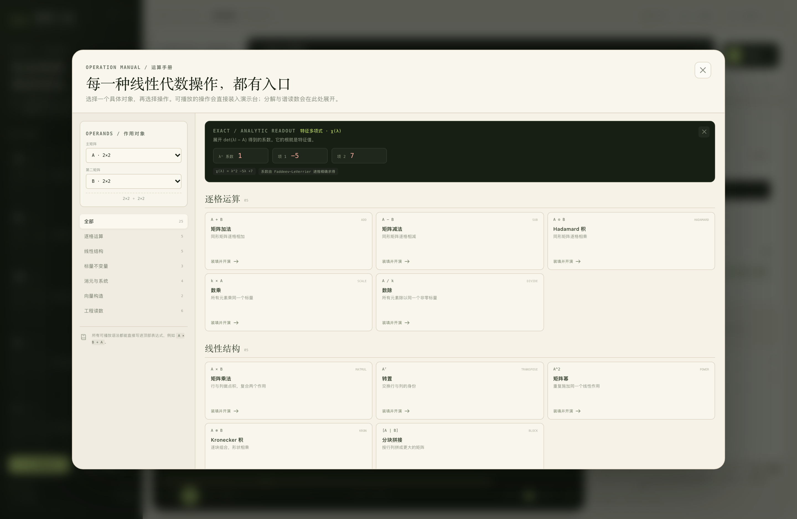

# 矩阵工坊 · Matrix Atelier

一座可以慢放观看的线性代数演示工作台。矩阵不是静态的表格：你可以创建任意对象，用运算符把它们连成表达式，装进常见公式模板，或者像积木一样拼成更大的矩阵；然后在舞台上逐帧看每一个数字被哪一条规则扫过、如何累加、如何收束到最后的形状。


## 启动

环境要求：Node.js 20+、npm；首次安装需要下载 Electron。

```bash
npm install
npm start
```

也可以直接双击 `start.command`。`npm start` 会先构建前端，再打开 Electron 桌面窗口。

开发模式：

```bash
npm run dev            # 终端 A：Vite
npm run dev:electron   # 终端 B：Electron + HMR
```

> 如果 macOS 的受限终端环境拒绝 Electron 自带的 Chromium sandbox，可临时使用
> `MATRIX_NO_SANDBOX=1 npm start` 启动（仅用于本地演示环境）。

## 它能做什么

### 1. 任意矩阵对象

- 1×1 到 10×10 矩阵，支持整数、小数和分数（`-3/4`、`1.5`、`2e-3` 等）。
- 内置 A、B、M、b、v 五个对象：两个 2×2 方阵、一个 3×3 方阵、两个 3×1 列向量。
- 支持批量粘贴、清零、单位阵、全 1、随机填充；一键改尺寸、改名、编辑任意元素。
- 所有核心运算使用**精确有理数**，不会出现 `0.30000000000000004`。

### 2. 表达式：用计算符号把对象连起来

顶部表达式栏既可输入，也可从矩阵库、运算符条、函数条直接插入：

```
(A + B) × A
A ⊙ B
Aᵀ
inv(A)
det(M)
rref(M)
solve(M, b)
A^2
2 × A
A ⊗ B
```

支持：

| 类别 | 语法 |
|---|---|
| 矩阵加减 | `A + B`、`A - B` |
| 矩阵乘法 | `A × B`、`A * B` |
| Hadamard 积 | `A ⊙ B` |
| Kronecker 积 | `A ⊗ B` |
| 转置 | `Aᵀ`、`A^T`、`transpose(A)` |
| 数乘 / 数除 | `2 × A`、`A / 2` |
| 整数幂 | `A^2`、`A^(-1)` |
| 标量不变量 | `det(A)`、`trace(A)`、`rank(A)` |
| 消元 | `rref(A)`、`inv(A)` |
| 线性方程组 | `solve(A, b)` |
| 伴随 / 余子式 | `adj(A)`、`minor(A, i, j)` |

表达式支持括号、运算优先级和复合子表达式。像 `A × B + A` 这样的表达式会被拆成若干独立运算层，逐层播放，不会跳过中间对象。

### 3. 公式模板

11 条可装填的公式模板：矩阵乘法、Hadamard 积、逆矩阵（高斯–若尔当）、行列式（余子式展开）、RREF、秩、解方程组、转置、矩阵幂、Kronecker 积、矩阵加法，以及分块组合入口。

模板只固定公式的形状约束；你需要把**当下矩阵库里的具体矩阵**放进槽位。装填前会做形状预检，例如矩阵乘法的内维、解方程组的方阵与右端向量、求逆的行列式非零检查。


### 4. 分块组合

把矩阵当作积木拼成更大的矩阵：

- 水平 `[A | B]`、竖直 `[A ; B]`、2×2 分块、自定义最多 3×3 个块位。
- 自动搭配兼容的块，并对“块行等高、块列等宽”做严格检查。
- 显示块行高度、块列宽度和整体形状。
- 拼合后的矩阵自动加入矩阵库，并进入“逐格搬运”动画：每一个数字从哪里来、搬到大矩阵的哪个全局坐标，都可以慢放查看。


### 5. 可调速度的动画驱动器

每个操作都由真实的数字运算生成帧脚本，而不是预先录制的视频：

- **逐帧播放 / 暂停 / 前进 / 后退**
- 时间轴任意拖动，支持按章节跳转
- 速度 `0.25×` 到 `3.0×`，播放中也可随时调整
- 键盘：`Space` 播放/暂停，`←` `→` 逐帧，`Shift + ←/→` 跨章节
- 每一个数字都有来源高亮、目标高亮、当前累加值和“此刻规则”说明

不同操作有不同层次的帧：

- **加减 / Hadamard / 数乘**：逐格扫描，同坐标的两个数如何合成一个结果。
- **矩阵乘法**：每个输出格逐项展开，行与列分别高亮，k 项乘积依次加入累加器。
- **行列式**：沿含零最多的一行做 Laplace 展开，每一项都有符号、余子式、贡献值，最后合拢为有向体积缩放因子。
- **高斯–若尔当 / RREF / 解方程组**：保留每一次换行、归一、消元前后的行值，逐行变化可见。
- **转置**：逐元素展示 `(i,j) → (j,i)` 的坐标翻转。
- **Kronecker 积**：外层一个元素如何生成并缩放一整块内层矩阵。
- **分块组合**：逐格搬运，源矩阵坐标映射到组合矩阵的全局坐标。

演算台的右侧面板始终保留 **形状契约** 和 **含义**：

- `2×2 × 2×2 → 2×2`
- `3×3 → 标量`
- `[3×3 | 3×1] → 3×1`
- `2×2 块格 → 6×4`

最终幕会把所有中间步骤收束回一个最简表达（矩阵或标量），并允许把矩阵结果直接存回矩阵库，继续参与后续表达式或分块组合。

### 6. 运算手册与高级读数

顶部「运算手册」汇集 25 个操作入口。可以点选操作对象，直接装填并开演，或打开精确/数值读数：

- 内积、外积
- LU 分解（`PA = LU`）
- QR 分解（Gram–Schmidt 数值读数）
- 特征值
- 特征多项式（Faddeev–LeVerrier）
- 零空间
- Frobenius 范数
- 精确矩阵运算、消元、伴随矩阵、Kronecker 积等



## 数据与持久化

- 矩阵库、当前表达式、播放速度会自动写入浏览器/Electron 的本地存储。
- 「导出实验」会下载一个 JSON 快照，包含矩阵数据、当前表达式、规则、形状链和结果摘要。
- 不依赖网络；所有计算都在本地运行。
- 数值分解（QR、部分特征值）是近似读数，核心矩阵计算与求逆、消元、行列式均使用精确有理数。

## 键盘

| 快捷键 | 动作 |
|---|---|
| `Space` | 播放 / 暂停 |
| `←` / `→` | 上一帧 / 下一帧 |
| `Shift + ←/→` | 上一幕 / 下一幕 |
| `Enter` | 在表达式栏中开演 |
| `Esc` | 关闭弹窗 |

## 项目结构

```
electron/
  main.cjs              Electron 主进程、窗口与原生菜单
  preload.cjs           安全的运行时信息桥
src/
  engine/
    rational.js         BigInt 精确有理数
    matrix.js           矩阵运算、消元轨迹、LU/QR/特征值
    expression.js       表达式词法/语法分析、求值与运算轨迹
    stories.js          逐帧动画脚本、章节与最终表达
  components/           舞台、矩阵网格、矩阵库、编辑器、模板、组合器、运算手册
  data/seed.js          初始矩阵、模板与运算手册元数据
  App.jsx               工作台状态与流程编排
scripts/
  engine-check.mjs      引擎与表达式回归测试
  launch-electron.mjs   Electron 启动器
screenshots/            实机截图
```

## 验证

```bash
npm test
```

当前回归覆盖：有理数解析、加减乘、行列式、逆、RREF、秩、零空间、解方程组、LU 重构、分块拼接、Kronecker 积、伴随矩阵、特征值、QR 重构、标量与矩阵复合表达式，以及全部表达式模板与错误输入。

```text
85 passed, 0 failed
```

界面在 1440×940、1280×800、1120×760 三档窗口下均完成布局与交互检查，Electron 生产构建可正常加载。
