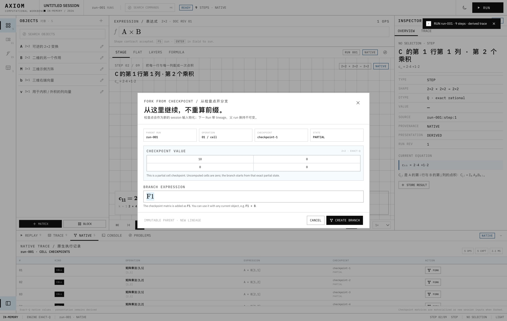
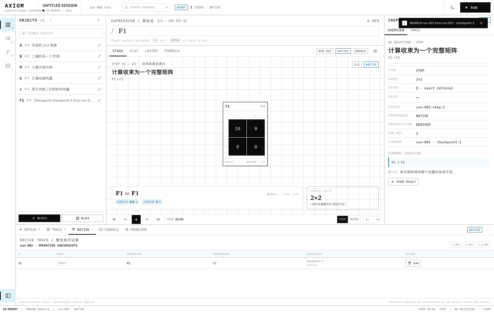
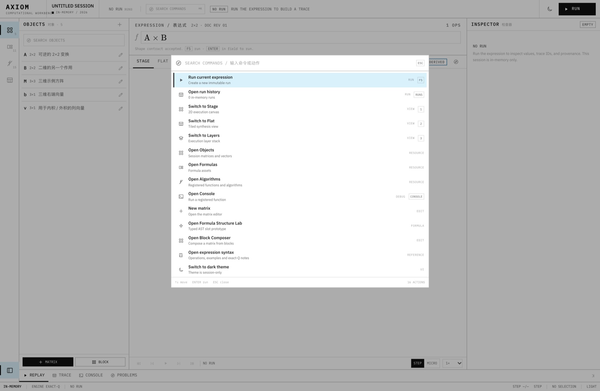
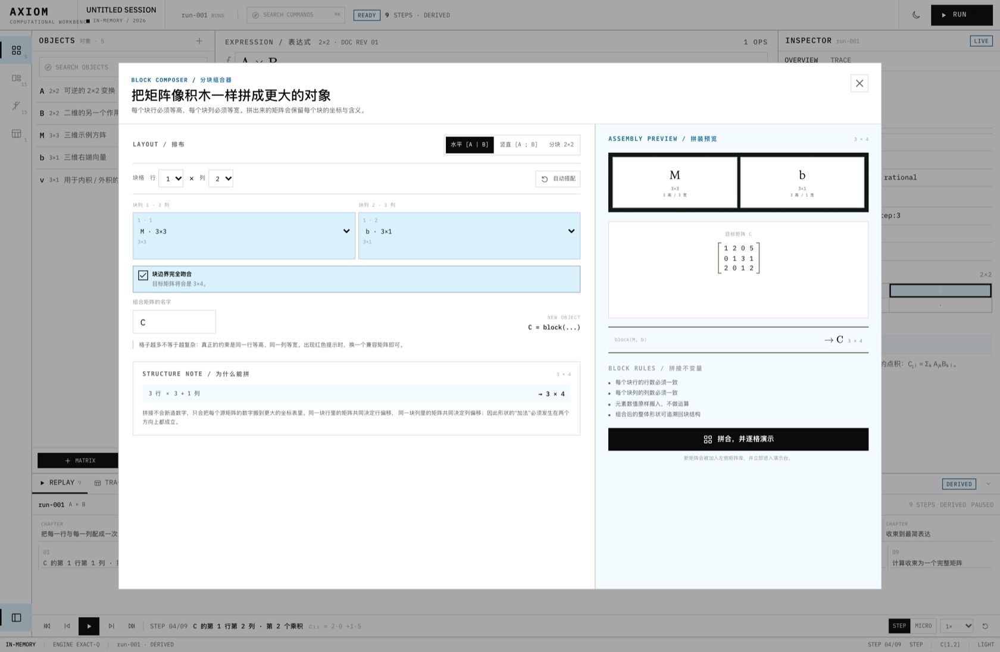
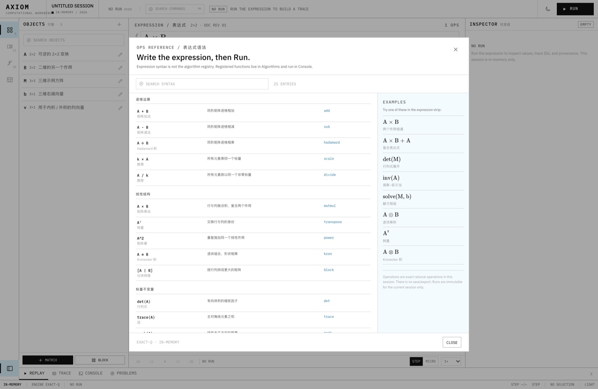
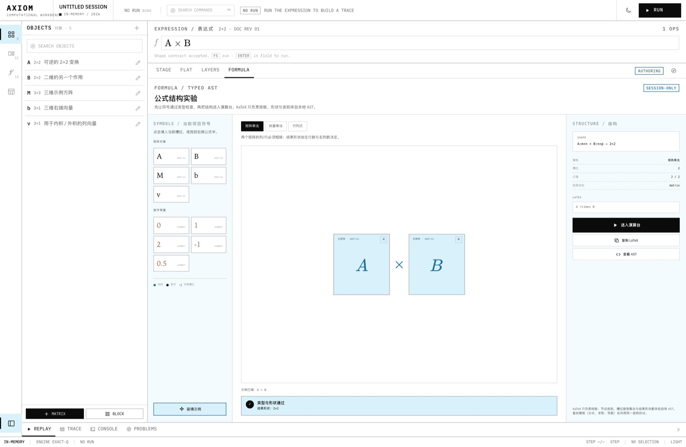

# Axiom · Computational Workbench

Axiom 是一套本地优先、可检查执行过程的数学工作台。它把矩阵与公式变成**不可变的运行记录**：一次计算可以被运行、暂停、逐步骤检查、切到平铺/层叠视图重播，而重播本身不会再次执行数学。

当前版本是 **Phase B + C + D + E**：Axiom 工程壳层与 Replay 之外，expression run 现在带 exact-Q native checkpoints，并支持从 checkpoint 物化状态后创建真实 lineage 分支。设计/实施记录见 [docs/axiom](docs/axiom/README.md)。


## 当前已实现

### Axiom 工程界面

- 纯白工程纸面、墨黑文字、天蓝单色阶；0–2px 圆角、1px 硬线、无渐变/发光/模糊。
- Light 为默认主题，可切换深色；深色是近黑底 + 白字 + 亮蓝，不再使用旧奶油/青柠/珊瑚。
- 活动栏 + 资源 dock + 中央表达式/视图 + 检查器 + 底部 Replay dock + 状态栏。
- 资源：Objects / Formulas / Algorithms / Runs。
- **命令面板**：`⌘/Ctrl+K` 搜索 Run、视图切换、资源、Console、Block Composer、Syntax、主题与布局动作。
- **可拖拽分栏**：资源栏、检查器和底部 Replay dock 都可调整尺寸，且会保护中央画布的最小宽度。
- **没有持久化。** 所有矩阵、运行、重播状态都只在当前 session；应用状态栏和顶栏持续显示 `IN-MEMORY`。刷新后回到 seed session，这是本阶段的明确设计，不是缺陷。

### Run / Trace / Replay

- 每次 Run 捕获文档 revision、表达式与计算时间，生成不可变的 `RunRecord`。
- **Expression run 的 trace 已 native 化**：直接记录 exact-Q 的 operation/cell checkpoints；Stage/Flat/Layers 仍是 derived presentation，两者分别显示。
- 默认按执行步骤播放；可切换 `STEP / MICRO` 粒度。
- 播放/暂停、前后步骤、首尾跳转、倍速、loop、时间轴跳转；从旧运行打开时落在末尾，按播放从头重播。
- 选择 trace 行 / 时间轴 step / 矩阵 cell，场景、Trace、检查器同步。
- 编辑表达式或矩阵不会覆盖旧 run；旧 run 变为 `STALE`，仍可完整重播。再次 Run 会创建新 run。
- seek、拖动时间轴、切换视图都不调用数学引擎；对应 runtime 测试会阻止重算回归。
- 不再有“假 fork”：只有带 native checkpoint 的 run 才能从 CHECKPOINT 开分支；分支会把 checkpoint 矩阵物化为新对象，再创建带 `parentRunId / checkpointId` lineage 的新 run。
- Function/block run 没有 native checkpoint，继续标 derived，也不会显示可点的 FORK。


### Native trace 与 checkpoint fork

- 底部 `NATIVE` tab 展示 exact-Q 操作、cell checkpoint、partial/complete 状态。
- `A × B` 的展示故事板仍是 9 步 derived presentation；native trace 是 4 个 cell + 1 个 result checkpoint。
- `FORK` 会把检查点矩阵物化为 `F1` 等 session 对象，用户可改写成 `F1 × B` 等分支表达式。
- 分支 run 在 viewbar/Inspector 显示 `NATIVE`、`BRANCH`、`LINEAGE`，父 run 保持不可变。





### 数学与视图

- 精确有理数矩阵内核（BigInt/Q），支持 1×1 到 10×10 矩阵，整数、小数、分数。
- 表达式：`+ − × ÷ ^`、`⊙`、`⊗`、转置、`det / inv / rank / trace / rref / adj / solve / minor`；复合表达式自动拆解。
- 11 条公式模板，经新的 Axiom Formula Asset 对话框装填；不再打开旧的画廊模态。
- **Formula 中央视图**：Stage/Flat/Layers 之外新增 FORMULA 视图，typed AST / 槽位 / 形状检查直接在中央编辑；旧的 FormulaLab 模态已移除。
- Block Composer 与表达式 Syntax reference 已迁入新 Axiom IA。
- 2D Stage、Flat 平铺、Layers 执行层叠共享同一份 Scene + 同一 cursor/selection。
- 矩阵 cell 使用天蓝/黑/白语义高亮；没有第三色相。
- Inspector 展示 shape、dtype、value、source step、provenance、microframes；结果矩阵可存回当前 session。
- Scene `schemaVersion: 2`，scene/node 带 `sourceStepId` / `sourceValueIds`，并加入 SceneGroup 与 a11y table fallback；供视图与检查器反查。


### 函数与 Console

- 15 个注册算法：matmul、add、Hadamard、det、inverse、rref、transpose、solve、LU、QR、eigenvalues、charpoly、nullspace、dot、outer。
- Console 可选择函数、编辑 JSON args、运行、查看 artifacts / trace / storyboard。
- 有 story 的函数可生成 function Run，并进入同一个 Replay/Trace 系统。
- Problems 面板把失败运行变成结构化诊断，不伪造成功状态。


### 工作台工具

- **命令面板**：`⌘/Ctrl+K`，支持搜索、键盘选择、执行；没有隐藏的控制台命令。
- **Block Composer**：从 Objects 资源或命令面板打开；横排、竖排、2×2、自定义布局，检查块边界后生成组合矩阵，并直接创建可重播的 derived run。
- **Syntax reference**：从 Algorithms 资源或命令面板打开；按分组浏览表达式语法、说明和 examples。它和执行器分离，不伪装成算法运行。
- **可拖拽分栏**：resource dock / inspector / replay dock 均可拖拽调整，布局只在内存。







### 公式资产与结构实验

- 公式模板装填：Axiom 风格的 Formula Asset 对话框，验证 shape 约束后创建新 run。
- Formula structure 已进入中央 FORMULA 视图；完整通用公式编辑器仍后置。
- 保留临时 MatrixEditor：矩阵编辑仍可完成，完整重做留给后续。




### 深色主题


## 启动

```bash
npm install
npm start
```

`npm start` 会构建 renderer 与 Electron 主进程，然后打开桌面窗口。也可以双击 `start.command`。

```bash
npm run dev             # Vite
npm run dev:electron    # Electron + 已有 Vite
npm run typecheck       # renderer + electron 双 strict 检查
npm test                # Vitest
npm run build           # 生产构建
```

受限环境中若 Chromium sandbox 无法启动：

```bash
MATRIX_NO_SANDBOX=1 npm start
```

## 快捷键

| 键 | 动作 |
|---|---|
| `⌘/Ctrl + K` | 打开命令面板 |
| `1` / `2` / `3` / `4` | Stage / Flat / Layers / Formula |
| `⌘/Ctrl + J` | 打开 Console |
| `N` / `B` / `?` | 新建矩阵 / Block Composer / Syntax reference |
| `[` / `]` | 清除 / 设置 replay loop |
| `F5` | 运行当前表达式 |
| `Space` | 播放 / 暂停重播 |
| `←` / `→` | 上一/下一 step（Micro 模式下为 microframe） |
| `Shift + ←/→` | 上一/下一 step |
| `Home` / `End` | Run 首 / 尾 |
| `Esc` | 关闭浮层 |

主流程均可用鼠标完成。

## 架构

```text
Axiom shell / components
        │
        ▼
WorkbenchStore (document, runs, replay, selection)
        │
        ▼
ExactEngineAdapter (current Q engine + story compiler)
        │
        ▼
DerivedTraceAdapter → RunRecord / Trace / StageFrame / Scene
        │
        ▼
Replay cursor + selectors
        │
        ▼
StageView / FlatView / LayersView / Inspector / Trace / ReplayDock
```

关键边界：

- `src/runtime/` 不依赖 React/DOM；Run 与 Trace 的不可变性由 runtime + tests 保证。
- `src/core/` 继续作为纯精确计算内核，不知道 UI、Replay 或 CSS。
- 新 UI 只通过 `WorkbenchStore` 发起运行，seek/视图切换不触发 engine。
- Scene 是 renderer-neutral data；Flat/Layers 不直接调用数学函数。
- Expression run 已经带 native trace；presentation 仍然 derived；function/block run 仍为 derived。
- Native trace 与 presentation provenance 分开记录，不能用 Stage 的平滑动画冒充 native 执行。

目录：

```text
src/
  AxiomApp.tsx                  Axiom 工作台编排
  axiom/                        Axiom shell、视图、dock、主题
  runtime/                      Run/Trace/Replay store、native trace 与派生 presentation
  core/                         exact rational 内核、表达式、operations
  presentation/                 现有 Story 编译器（供 derived adapter 使用）
  scene/                        renderer-neutral Scene
  debug/                        算法注册表 + 函数调试数据模型（新 Console 使用）
  formula/                      headless formula AST / KaTeX / palette
  components/                   保留的临时 MatrixEditor 与 Block Composer
  content/                      示例矩阵与公式模板
  workspace/                    共享编辑器 payload 类型；旧项目存储已移除
docs/axiom/                     Phase B+C+D+E 设计、重播契约、实施记录
```

## 验证

- `npm run typecheck`：通过
- `npm test`：**104 项通过**
- `npm run build`：Vite + Electron 构建通过
- 已手工验证：
  - Run `A × B` → pause / seek / step / micro / flat / layers / cell selection
  - Native tab → 5 exact-Q checkpoints → fork partial F1 → branch expression `F1` → native run-002 with lineage
  - edit → stale → new run
  - determinant template → scalar run
  - Console `matmul` → artifacts → function run
  - Block Composer → 3×4 matrix → 13-step derived run
  - Command palette search/select/execute/Escape
  - Syntax reference search and examples
  - drag resource / inspector / replay dock; 1120×760 re-clamp
  - Formula 中央视图 → 装填示例 → 送入 Stage
  - Light / Dark；1440×940 与 1120×760；资源栏折叠
  - failed expression → Problems；没有成功态或结果假象


## 设计文档

- [Axiom 设计包](docs/axiom/README.md)
- [品牌、颜色、字体与组件规范](docs/axiom/00-brand-visual-system.md)
- [信息架构与工作台布局](docs/axiom/01-information-architecture.md)
- [重播、Trace 与时间轴契约](docs/axiom/02-replay-and-trace.md)
- [Runtime/IR 重构](docs/axiom/03-runtime-refactor.md)
- [实施计划](docs/axiom/04-delivery-plan.md)
- [Phase B + C 实施记录](docs/axiom/06-implementation-log.md)
- [Phase D 实施记录](docs/axiom/07-phase-d-log.md)
- [Phase E 实施记录](docs/axiom/08-phase-e-log.md)

## 本阶段明确后置

- 持久化：项目文件、保存/恢复、导出、旧数据迁移。
- native function/block trace（expression 已有 native trace）。
- Rust/WASM 核心、AD/VJP、MX/FP4–FP64 精度实验室。
- AST-level resumable checkpoint（当前 fork 是 checkpoint value materialization）。
- 完整通用 typed formula editor（当前中央视图仍是受控原型）。
- 可分离调试窗口、自定义命令与真正的多窗口调试。

> 目标仍是先把“运行、检查、重播、组合、分支”做成真实的产品能力，再扩大数学域与执行后端；不把尚未实现的 native/持久化能力做成假入口。
