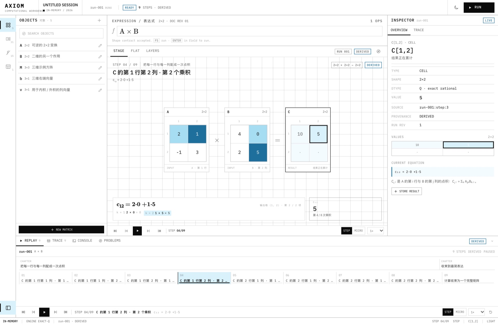
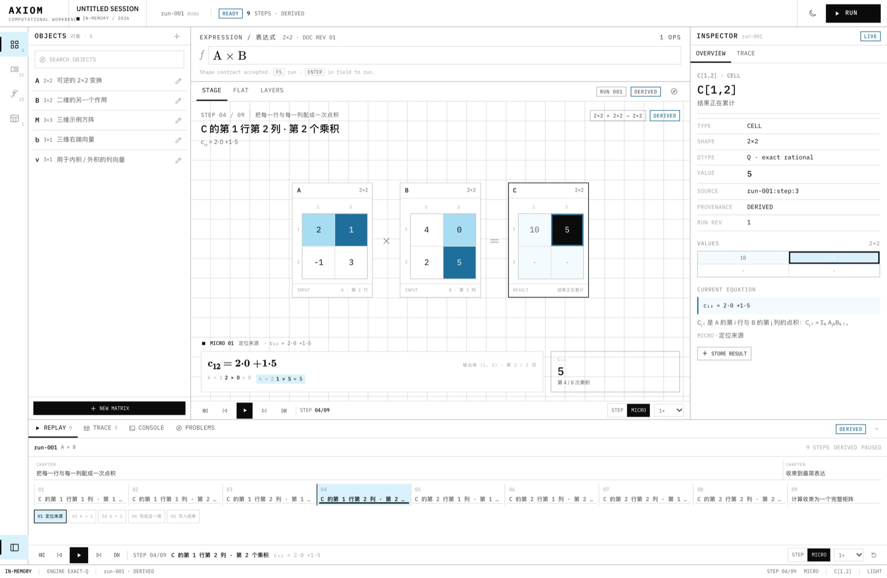
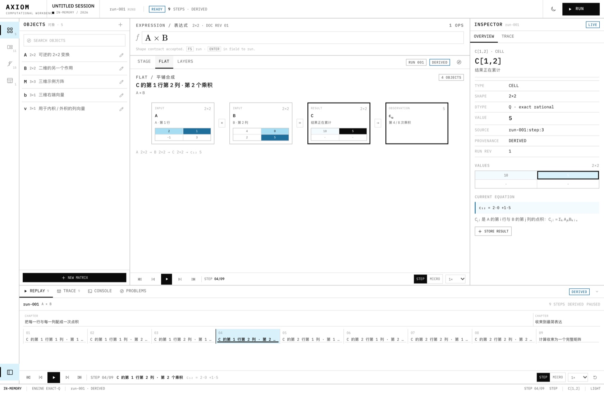
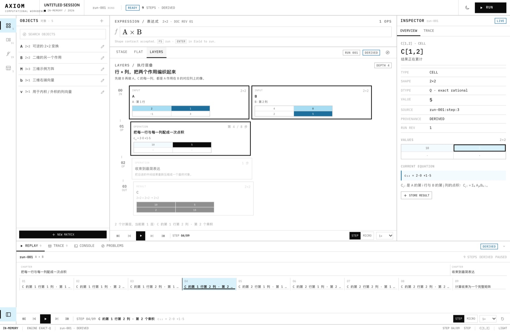
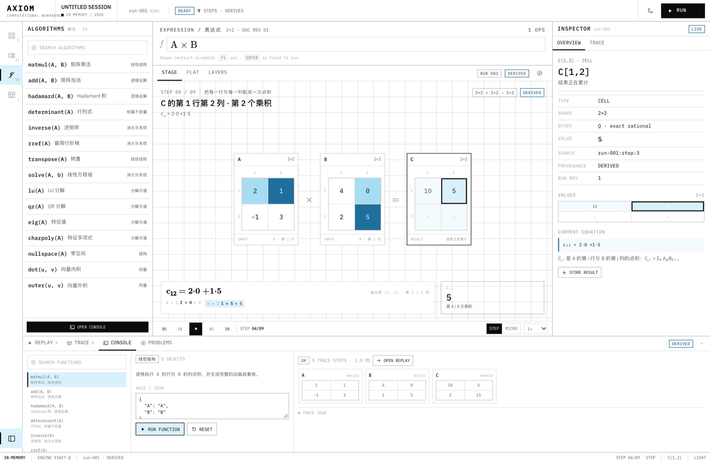
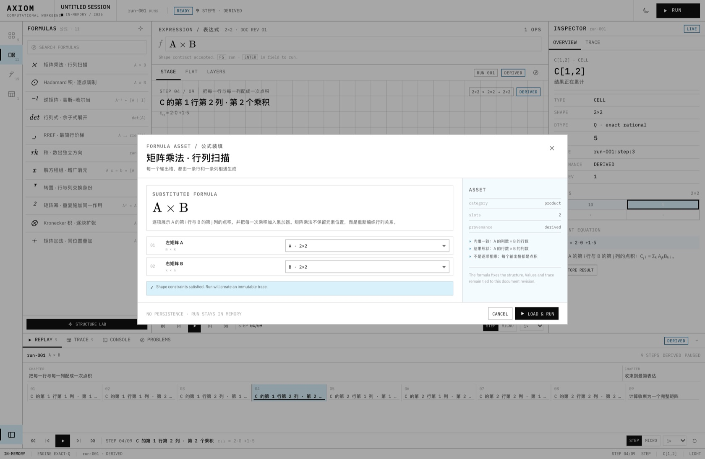
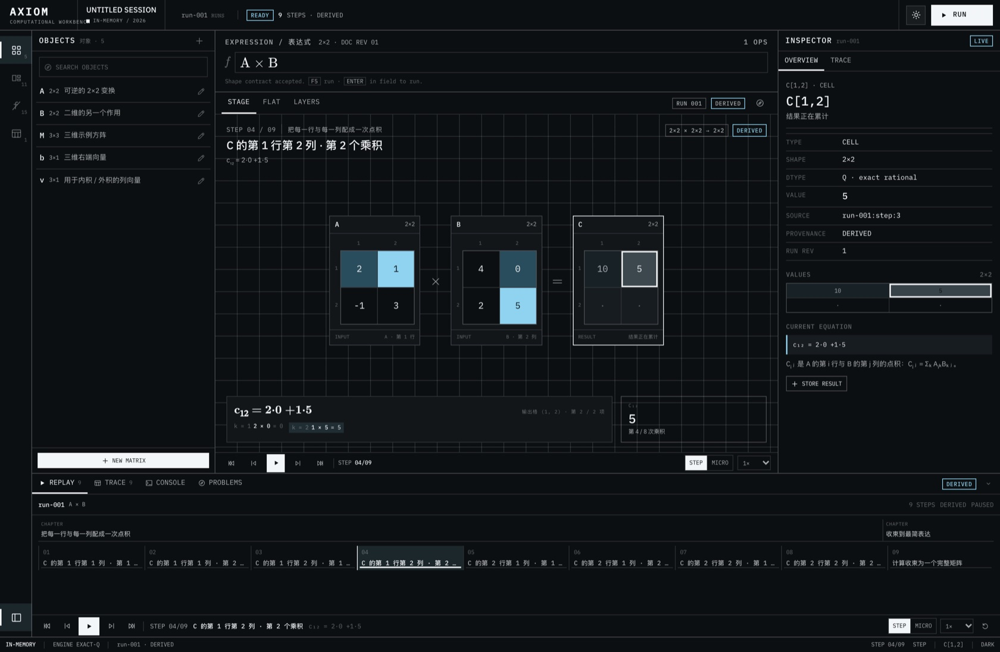
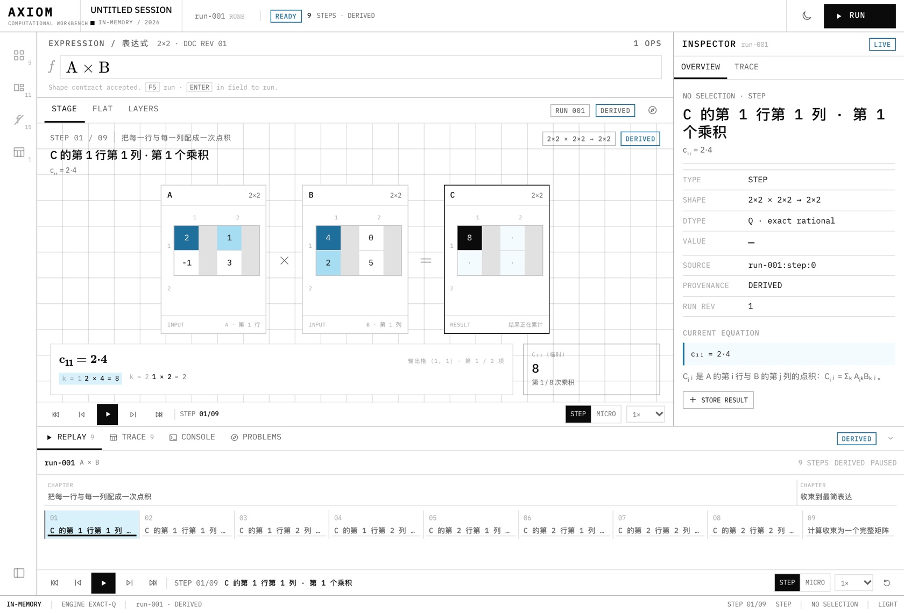

# Axiom · Computational Workbench

Axiom 是一套本地优先、可检查执行过程的数学工作台。它把矩阵与公式变成**不可变的运行记录**：一次计算可以被运行、暂停、逐步骤检查、切到平铺/层叠视图重播，而重播本身不会再次执行数学。

当前版本是 **Phase B + C 的第一刀**：Axiom 工程壳层 + 现有精确 Q 引擎上的 Run / Trace / Replay 闭环。设计冻结记录见 [docs/axiom](docs/axiom/README.md)。



## 当前已实现

### Axiom 工程界面

- 纯白工程纸面、墨黑文字、天蓝单色阶；0–2px 圆角、1px 硬线、无渐变/发光/模糊。
- Light 为默认主题，可切换深色；深色是近黑底 + 白字 + 亮蓝，不再使用旧奶油/青柠/珊瑚。
- 活动栏 + 资源 dock + 中央表达式/视图 + 检查器 + 底部 Replay dock + 状态栏。
- 资源：Objects / Formulas / Algorithms / Runs。
- **没有持久化。** 所有矩阵、运行、重播状态都只在当前 session；应用状态栏和顶栏持续显示 `IN-MEMORY`。刷新后回到 seed session，这是本阶段的明确设计，不是缺陷。

### Run / Trace / Replay

- 每次 Run 捕获文档 revision、表达式与计算时间，生成不可变的 `RunRecord`。
- 当前 trace 从现有故事板派生，统一标识 `provenance: derived`；不伪装成内核级 native trace。
- 默认按执行步骤播放；可切换 `STEP / MICRO` 粒度。
- 播放/暂停、前后步骤、首尾跳转、倍速、loop、时间轴跳转；从旧运行打开时落在末尾，按播放从头重播。
- 选择 trace 行 / 时间轴 step / 矩阵 cell，场景、Trace、检查器同步。
- 编辑表达式或矩阵不会覆盖旧 run；旧 run 变为 `STALE`，仍可完整重播。再次 Run 会创建新 run。
- seek、拖动时间轴、切换视图都不调用数学引擎；对应 runtime 测试会阻止重算回归。
- 当前**没有**真正的 step-level fork。RunRecord 预留 lineage，但 UI 不提供无法兑现的分支按钮。



### 数学与视图

- 精确有理数矩阵内核（BigInt/Q），支持 1×1 到 10×10 矩阵，整数、小数、分数。
- 表达式：`+ − × ÷ ^`、`⊙`、`⊗`、转置、`det / inv / rank / trace / rref / adj / solve / minor`；复合表达式自动拆解。
- 11 条公式模板，经新的 Axiom Formula Asset 对话框装填；不再打开旧的画廊模态。
- 分块组合、旧 ops 手册仍在旧实现中，Phase D 再迁入新资源架。
- 2D Stage、Flat 平铺、Layers 执行层叠共享同一份 Scene + 同一 cursor/selection。
- 矩阵 cell 使用天蓝/黑/白语义高亮；没有第三色相。
- Inspector 展示 shape、dtype、value、source step、provenance、microframes；结果矩阵可存回当前 session。





### 函数与 Console

- 15 个注册算法：matmul、add、Hadamard、det、inverse、rref、transpose、solve、LU、QR、eigenvalues、charpoly、nullspace、dot、outer。
- Console 可选择函数、编辑 JSON args、运行、查看 artifacts / trace / storyboard。
- 有 story 的函数可生成 function Run，并进入同一个 Replay/Trace 系统。
- Problems 面板把失败运行变成结构化诊断，不伪造成功状态。



### 公式资产与结构实验

- 公式模板装填：Axiom 风格的 Formula Asset 对话框，验证 shape 约束后创建新 run。
- 保留临时 FormulaLab：typed AST / KaTeX / 槽位吸附 / 结构预览；完整公式编辑器仍后置。
- 保留临时 MatrixEditor：矩阵编辑仍可完成，Phase D 再完全重做。



### 深色主题



## 启动

```bash
npm install
npm start
```

`npm start` 会构建 renderer 与 Electron 主进程，然后打开桌面窗口。也可以双击 `start.command`。

```bash
npm run dev             # Vite
npm run dev:electron    # Electron + 已有 Vite
npm run typecheck       # renderer + electron 双 strict 检查
npm test                # Vitest
npm run build           # 生产构建
```

受限环境中若 Chromium sandbox 无法启动：

```bash
MATRIX_NO_SANDBOX=1 npm start
```

## 快捷键

| 键 | 动作 |
|---|---|
| `F5` | 运行当前表达式 |
| `Space` | 播放 / 暂停重播 |
| `←` / `→` | 上一/下一 step（Micro 模式下为 microframe） |
| `Shift + ←/→` | 上一/下一 step |
| `Home` / `End` | Run 首 / 尾 |
| `Esc` | 关闭浮层 |

主流程均可用鼠标完成。

## 架构

```text
Axiom shell / components
        │
        ▼
WorkbenchStore (document, runs, replay, selection)
        │
        ▼
ExactEngineAdapter (current Q engine + story compiler)
        │
        ▼
DerivedTraceAdapter → RunRecord / Trace / StageFrame / Scene
        │
        ▼
Replay cursor + selectors
        │
        ▼
StageView / FlatView / LayersView / Inspector / Trace / ReplayDock
```

关键边界：

- `src/runtime/` 不依赖 React/DOM；Run 与 Trace 的不可变性由 runtime + tests 保证。
- `src/core/` 继续作为纯精确计算内核，不知道 UI、Replay 或 CSS。
- 新 UI 只通过 `WorkbenchStore` 发起运行，seek/视图切换不触发 engine。
- Scene 是 renderer-neutral data；Flat/Layers 不直接调用数学函数。
- 当前 trace 是 derived；native trace 是后续引擎阶段的目标，不混淆两者。

目录：

```text
src/
  AxiomApp.tsx                  Axiom 工作台编排
  axiom/                        Axiom shell、视图、dock、主题
  runtime/                      Run/Trace/Replay store 与派生适配器
  core/                         exact rational 内核、表达式、operations
  presentation/                 现有 Story 编译器（供 derived adapter 使用）
  scene/                        renderer-neutral Scene
  debug/                        算法注册表 + 旧调试实现（新 Console 仍使用 registry）
  formula/                      headless formula AST / KaTeX / palette
  components/                   保留的临时 MatrixEditor / FormulaLab
  content/                      示例矩阵与公式模板
  workspace/                    旧项目存储（新 Axiom 未挂载）
docs/axiom/                     Phase B+C 设计、重播契约、实施记录
```

## 验证

- `npm run typecheck`：通过
- `npm test`：**102 项通过**
- `npm run build`：Vite + Electron 构建通过
- 已手工验证：
  - Run `A × B` → pause / seek / step / micro / flat / layers / cell selection
  - edit → stale → new run
  - determinant template → scalar run
  - Console `matmul` → artifacts → function run
  - FormulaLab → send to stage
  - Light / Dark；1440×940 与 1120×760；资源栏折叠
  - failed expression → Problems；没有成功态或结果假象



## 设计文档

- [Axiom 设计包](docs/axiom/README.md)
- [品牌、颜色、字体与组件规范](docs/axiom/00-brand-visual-system.md)
- [信息架构与工作台布局](docs/axiom/01-information-architecture.md)
- [重播、Trace 与时间轴契约](docs/axiom/02-replay-and-trace.md)
- [Runtime/IR 重构](docs/axiom/03-runtime-refactor.md)
- [实施计划](docs/axiom/04-delivery-plan.md)
- [Phase B + C 实施记录](docs/axiom/06-implementation-log.md)

## 本阶段明确后置

- 持久化：项目文件、保存/恢复、导出、旧数据迁移。
- 真正的 step checkpoint / fork。
- native kernel trace、Rust/WASM 核心、AD/VJP、MX/FP4–FP64 精度实验室。
- 完整 typed formula editor、Block Composer / Ops 手册的新 IA 迁移。
- Scene v2、可拖拽分栏、命令面板、可分离调试窗口。

> 目标是先把“运行、检查、重播”做成真实的产品能力，再扩大数学域与执行后端；不把尚未实现的 native/fork/持久化能力做成假入口。
