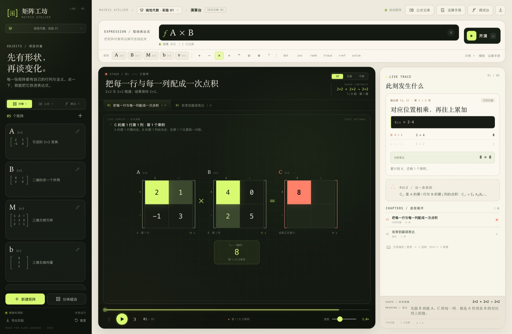
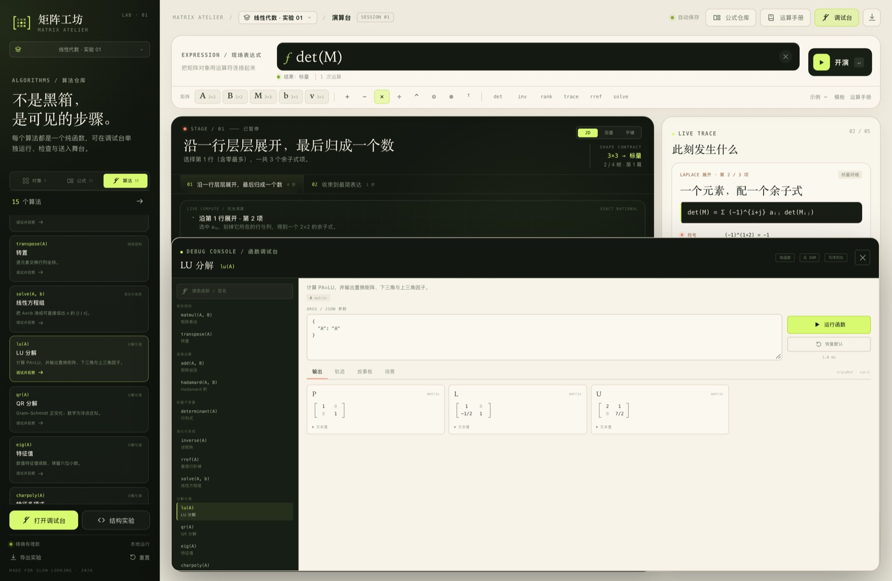
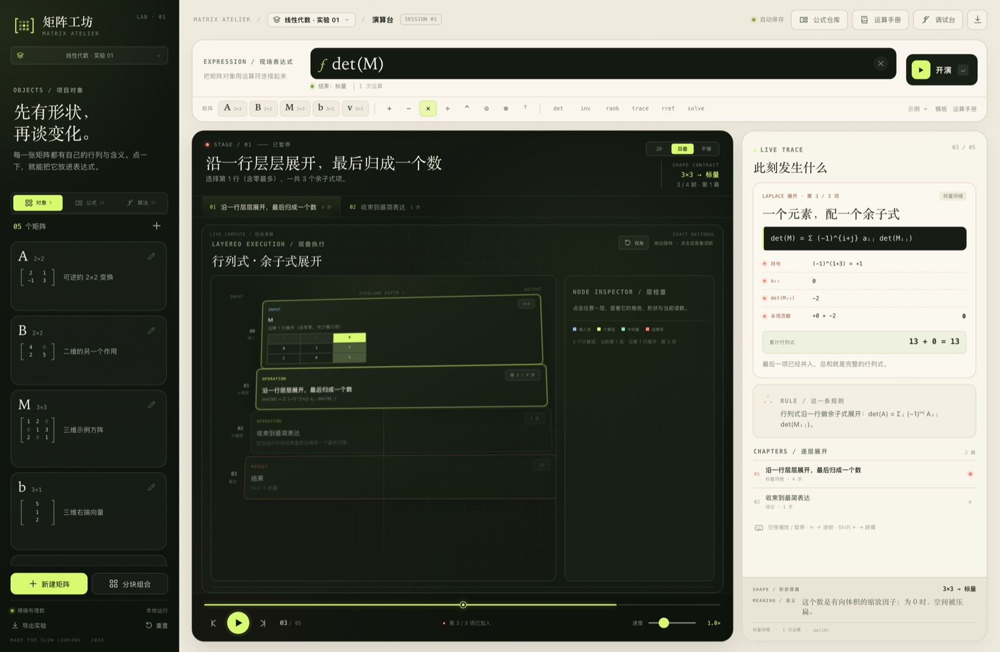
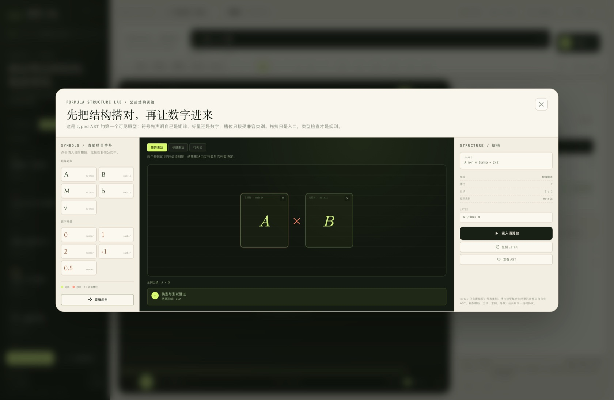

# 矩阵工坊 · Matrix Atelier

一座可以慢放、拆开、重新组合的数学工作台。当前聚焦线性代数，但底层从第一天起就按“通用数学对象 + 可观察执行 + 可插拔视图”的方向搭建。

> 本轮里程碑：全量 TypeScript 迁移、严格的计算/表示/渲染分层、函数注册表与调试控制台、项目/公式/算法仓库外壳、2.5D 层叠与平铺视图原型，以及长期设计文档。



## 启动

环境要求：Node.js 20+、npm；首次安装需要下载 Electron。

```bash
npm install
npm start
```

也可以双击 `start.command`。`npm start` 会构建 renderer 与 Electron 主进程，然后打开桌面窗口。

```bash
npm run dev            # 终端 A：Vite
npm run dev:electron   # 终端 B：编译 Electron 并连接 Vite
npm run typecheck      # 全量 strict TypeScript 检查
npm test               # Vitest：数学引擎 / 调试注册表 / Scene 边界 / 架构约束
```

> 如果受限的 macOS 终端环境拒绝 Electron 自带的 Chromium sandbox，可临时使用
> `MATRIX_NO_SANDBOX=1 npm start`。普通桌面环境不需要这个开关。

## 这一版已经有什么

### 演算内容

- **任意矩阵对象**：1×1 到 10×10，整数、小数、分数；编辑、批量粘贴、随机/单位阵/零阵；支持多项目独立矩阵库。
- **表达式**：`+ − × ÷ ^`、`⊙`、`⊗`、转置、`det / inv / rank / trace / rref / adj / solve / minor`；复合表达式自动拆成逐层动画。
- **公式模板**：11 条线性代数模板，入场前完成形状与可逆性预检。
- **分块组合**：水平、竖直、最多 3×3 块位；逐格展示源坐标到全局坐标的搬迁。
- **结果入库**：矩阵结果可存回当前项目的矩阵库，继续参与表达式、块组合与算法调试。
- **高级读数**：LU、QR、特征值、特征多项式、零空间、内积、外积、Frobenius 范数等（在运算手册与调试台中）。
- **精确优先**：矩阵核心使用 BigInt 精确有理数；QR/部分特征值等数值过程明确标注近似。

### 可观察执行与调试

- **函数注册表**（`src/debug/registry.ts`）：每个算法都是独立纯函数条目，带签名、参数、默认值、输出、计算轨迹与场景。
- **调试控制台**：选择函数、编辑 JSON 参数、运行、查看输出矩阵/标量、逐条 Trace、故事板结构、Scene JSON，并把故事板送回主舞台。
- **计算轨迹**：一次运行有稳定 `runId`、输入输出引用、步骤、耗时与状态；Trace 是计算事实的传输格式。
- **函数面板**：已接入矩阵乘法、加法、Hadamard、行列式、逆、RREF、转置、线性方程组、LU、QR、特征值、特征多项式、零空间、内积、外积。
- **算法仓库**：左侧「算法」资产页直接列注册表中的全部算法，点击即进入对应调试现场。



### 项目与资产仓库

- **多项目**：顶栏项目切换器或侧栏项目条打开项目管理器；每个项目拥有独立矩阵、表达式、速度与更新时间。
- **本地持久化**：项目写入 `localStorage`（v2 schema）；旧版单工作区快照会自动迁移。
- **资产架**：左侧在「对象 / 公式 / 算法」之间切换，作为绘图软件式的素材/笔刷架；公式资产与算法资产可直接打开其配置或调试界面。
- **外壳方向**：左侧项目与资产架、中央演算舞台、右侧语义检查器、底部函数调试台；后续会加入真正的可拖拽分栏与可拆卸面板。


### 动画与视图

- **2D 逐帧舞台**：每个数字行列来源、当前产物、累加器与规则解释同步高亮。
- **速度与时间轴**：0.25×–3× 调速；拖拽、逐帧、章节跳转；`Space` / `←` / `→` / `Shift + ←/→`。
- **形状与含义契约**：舞台顶部与检查器底部始终显示形状链、规则和几何/线性映射含义。
- **2.5D 层叠**：输入层 → 计算层 → 中间层 → 结果层，纵向表示流水线深度；可拖动改变视角、点选层查看细节。目前是 CSS 2.5D 原型，不是完整 3D 编辑。
- **平铺合成**：当前步骤的矩阵、算子与读数被投射为空间中的“合成台”；输入串、算子窗口与输出轨道共享同一时间游标。
- **同一 Storyboard 生成两种 Scene**：2D 舞台、层叠、平铺、调试场景都只消费表示对象，不接触计算核心。




### 公式基础

- **公式结构实验**：已接入 KaTeX + typed AST 原型。符号带语义类别（矩阵/数字），公式槽位只接受兼容类型；支持点击或拖入、矩阵乘法/标量乘法/行列式三种结构、形状检查、AST/LaTeX 复制与送入演算台。
- **headless 公式层**：typed slots、语义类别、LaTeX 序列化、受限 HTML 注解渲染、拖拽调色板定义、31 项安全/往返测试。
- 完整公式编辑 UI（任意槽位嵌套、公式/算法块、正式/具体双视图）仍后置；当前原型是类型化槽位的第一个可用切片。路线见 [docs/03-formula-system.md](docs/03-formula-system.md)。



## 设计文档

这次不是只交代码，也把后续方向写成了可执行的契约：

- [产品愿景](docs/00-vision.md)
- [架构与边界](docs/01-architecture.md)
- [统一 Value / 自动微分 / MX 浮点](docs/02-values-autodiff.md)
- [公式系统与 KaTeX/typed AST](docs/03-formula-system.md)
- [视觉语言：项目架、2.5D、平铺、高维编码](docs/04-visual-language.md)
- [分期路线图 M0–M6](docs/05-roadmap.md)
- [研究笔记与来源](docs/06-research-notes.md)

核心立场：

- 计算 → Trace → Storyboard/Scene → Renderer，单向流动；渲染器只消费表示对象。
- 精确有理数、符号、浮点/MX、自动微分共享一个可序列化 Value 信封；跨精度必须显式 cast。
- 先做应用内函数调试闭环，再引入更多数学域和高维视图。
- 三维空间只承担位置/层级；超过三维的信息进入尺寸、纹理、边框、运动与切片，而不是发明新的垂直坐标轴。

## 表达式速查

| 类别 | 语法 |
|---|---|
| 加减 | `A + B`、`A - B` |
| 乘法 | `A × B`、`A * B` |
| Hadamard | `A ⊙ B` |
| Kronecker | `A ⊗ B` |
| 转置 | `Aᵀ`、`A^T`、`transpose(A)` |
| 数乘 / 数除 | `2 × A`、`A / 2` |
| 整数幂 | `A^2`、`A^(-1)` |
| 标量不变量 | `det(A)`、`trace(A)`、`rank(A)` |
| 消元 / 逆 | `rref(A)`、`inv(A)` |
| 线性系统 | `solve(A, b)` |
| 伴随 / 余子式 | `adj(A)`、`minor(A, i, j)` |
| 复合 | `(A + B) × A`、`A × B + A` |

## 键盘

| 快捷键 | 动作 |
|---|---|
| `Space` | 播放 / 暂停 |
| `←` / `→` | 上一帧 / 下一帧 |
| `Shift + ←/→` | 上一幕 / 下一幕 |
| `Enter` | 在表达式栏中开演 |
| `Esc` | 关闭弹窗/调试台 |

## 项目结构

```text
electron/
  main.ts                 Electron 主进程、安全窗口、原生菜单
  preload.ts              最小运行时桥
src/
  core/
    rational.ts           BigInt 精确有理数
    matrix.ts             矩阵运算、消元轨迹、LU/QR/特征值
    expression.ts         AST、解析、求值、运算记录
    protocol.ts           Runtime Value、Operation、Trace 协议
  presentation/
    storyTypes.ts         Storyboard 表示协议
    stories.ts            计算事实 → 教学故事板
  scene/
    types.ts              renderer-neutral Scene v1
    builders.ts           Storyboard → 层叠/平铺/Debug 场景投影
  renderers/
    scene/                2.5D 层叠与平铺渲染器
  debug/
    types.ts / registry.ts / DebugConsole.tsx
  formula/
    ast.ts / latex.ts / palette.ts     headless typed formula AST
  workspace/
    project.ts            多项目存储、迁移与序列化
  components/             现有 UI 面板、矩阵编辑器、公式/运算/项目弹窗
  App.tsx                 工作台编排
  styles.css
docs/                     长期设计文档
screenshots/              实机截图
```

## 验证状态

- `npm run typecheck`：renderer + Electron 双 tsconfig 通过。
- `npm test`：数学引擎、表达式故事、调试注册表、Scene 投影、架构边界测试通过（当前 95 项）。
- `npm run build`：Vite 与 esbuild Electron 构建通过。
- Electron 生产启动已实机验证。
- 已在 1440×940 与 1120×760 两档窗口检查布局。

## 当前边界

- 层叠/平铺是 Scene v1 原型，完整折叠、循环反馈通道、跨视图时间游标联动仍在路线图。
- 公式编辑器目前是矩阵乘法/标量乘法/行列式的 typed 槽位原型，尚未覆盖任意嵌套结构与公式块编排；不依赖 MathLive 产出的 MathJSON。
- 精确线性代数是当前事实层；符号、MXFP4–FP64、自动微分与其动画状态机是下一阶段（见 docs/02）。
- 项目目前存储于应用本地存储；文件型项目容器、版本快照与仓库 revision 是后续工作。
